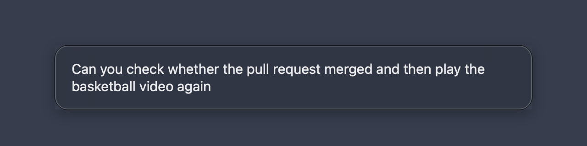

# VoiceType

Hold **Ctrl + Option**, talk, and let go. Your words show in a bubble as you speak, then the
text is typed wherever the cursor is.

The speech is turned into text on your Mac by [whisper.cpp](https://github.com/ggml-org/whisper.cpp),
so nothing is uploaded. A short sentence takes about half a second. The live words in the
bubble come from Apple’s on-device speech recognition, which is quicker but less accurate,
so the pasted text can differ slightly from what the bubble showed.

## Install

    ./install.sh

This installs whisper.cpp with Homebrew and downloads the English speech model and a second
one for meeting notes (about 470 MB each) if they're missing. Then it builds `~/Applications/VoiceType.app` and
starts it now and at every login. The first time, macOS asks to let VoiceType use the
microphone, Speech Recognition, Input Monitoring and Accessibility (System Settings → Privacy & Security). It needs
Accessibility to see the keys and to paste.

## Use

- **Hold Ctrl + Option** and talk. After a moment the menu bar mic turns red, plays a tick,
  and a bubble near the bottom of the screen shows your words as you say them.
- **Let go**, and the mic changes to dots while your speech becomes text. Then the text is pasted with a space after it.
- Holds shorter than a third of a second are ignored. Pressing any other key while
  holding Ctrl + Option cancels, so shortcuts that use those keys still work.
- Press **Esc** after letting go, while the dots show, to skip pasting the dictation. It is still in the menu to copy if you change your mind.
- Your clipboard is put back after each paste.

An orange crossed-out mic means VoiceType is still waiting for Accessibility, or that
whisper.cpp or the model is missing.

## Meeting notes

Choose **Start meeting notes** in the menu, and **Stop** when the meeting ends. VoiceType records
your mic as "You" and, on a call, the Mac's sound as "Others". Whisper turns both into a
transcript on this Mac, DeepSeek writes the summary, decisions and action items, and the note
opens from `~/Documents/Meeting Notes`. The audio is deleted afterwards. **Open Meeting Notes
folder** in the menu shows all of them.

- **In a room:** everyone is heard through the one mic, so the transcript can't name
  people, but each time someone new starts talking it starts a new line. A second, smaller
  English model (`ggml-small.en-tdrz.bin`, which the installer downloads) finds those
  changes. It works on real speech in English and can miss a change or add one.
- **Call audio:** the first time, macOS asks for Screen Recording. Without it, only the mic
  is recorded, which still works for a meeting in a room.
- **Summary:** needs a DeepSeek API key. Put `DEEPSEEK_API_KEY=sk-...` in
  `~/.config/voice-type/config`. Without one, the note has the transcript and says why
  there's no summary.
- **Privacy:** the transcript is sent to DeepSeek; the audio never leaves the Mac.
- **Consent:** tell people you're recording.

## Notes

- `install.sh` creates a private "VoiceType Local Signing" certificate in your login keychain
  (`make-cert.sh`) and signs every build with it, so macOS keeps the permissions across rebuilds.
- The final text uses `ggml-large-v3-turbo-q5_0.bin` from `~/.local/share/voice-type` if it
  is there, otherwise `ggml-small.en.bin`. Set `VOICE_TYPE_MODEL` to use another model file.
- Log: `~/Library/Logs/voice-type.log`. To remove VoiceType and its certificate, run `./uninstall.sh` (add `--models` to delete the speech models too). Installing again afterwards makes a new certificate, so macOS asks for the permissions again.
- Tests for the text handling: `tests/run.sh`.
